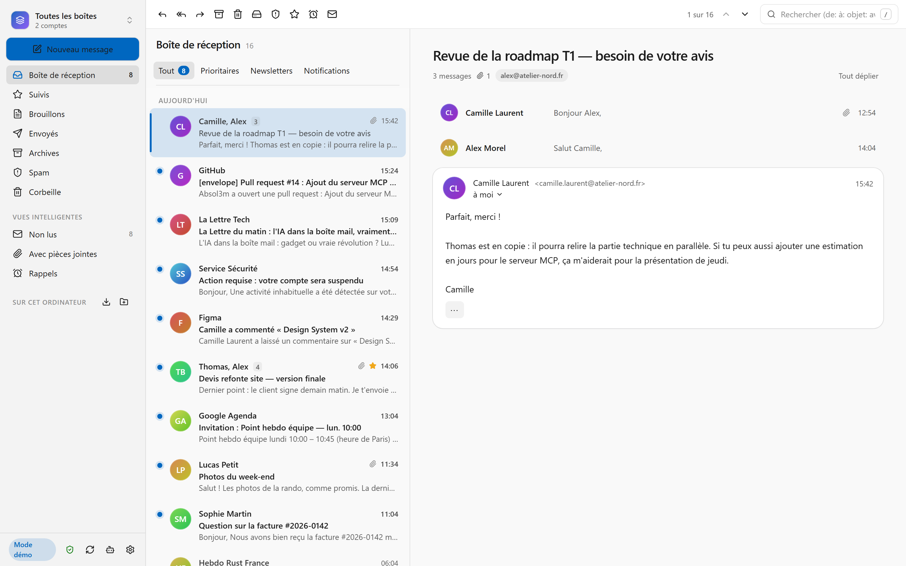
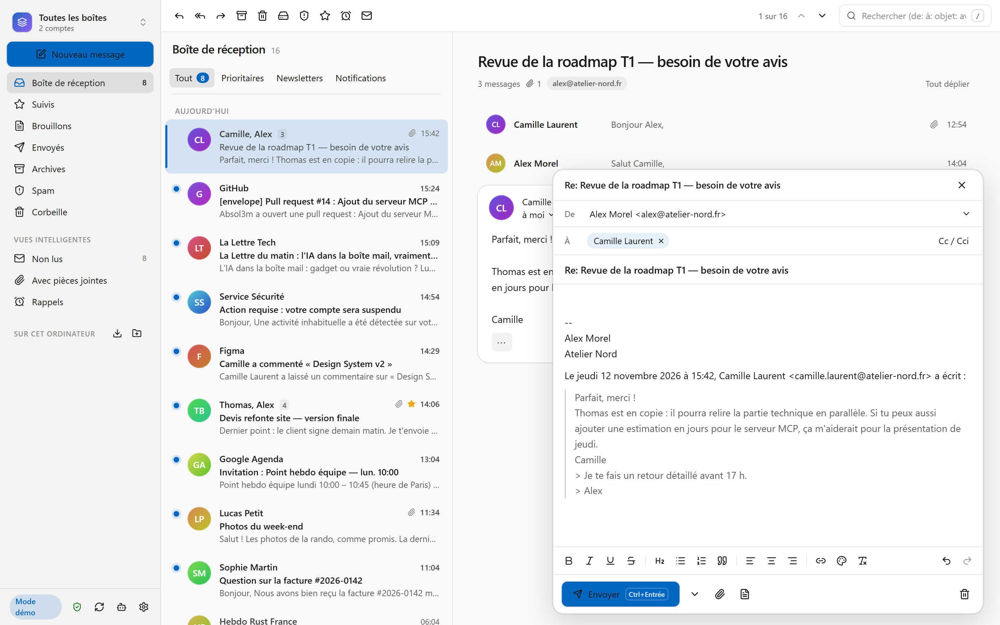
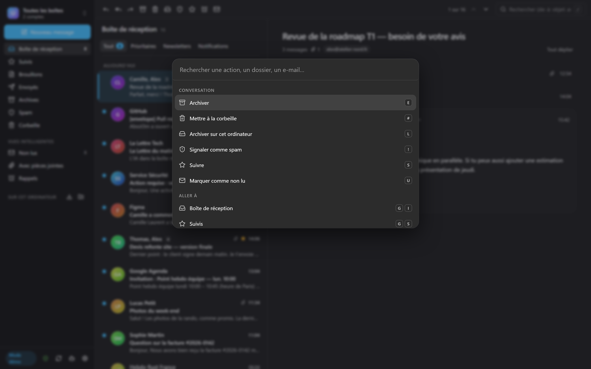
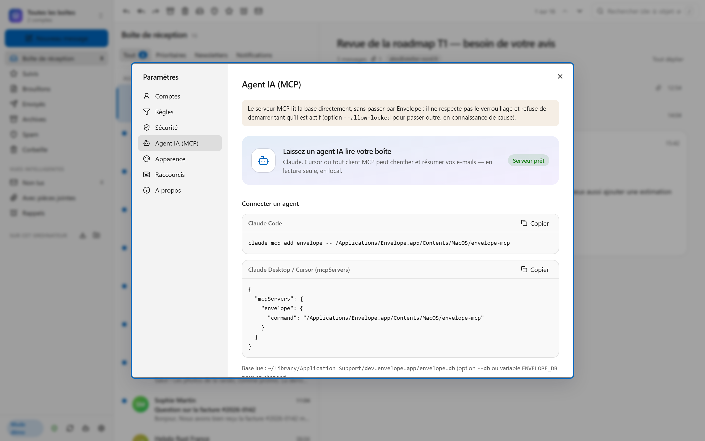

<p align="center">
  
</p>

<h1 align="center">Envelope</h1>

<p align="center">
  A fast, native-feeling desktop mail client for Windows, macOS and Linux,<br>
  with a built-in MCP server so AI agents can read your mail — locally, and read-only.
</p>

<p align="center">
  <a href="https://github.com/Absol3m/envelope/releases"></a>
  <a href="https://github.com/Absol3m/envelope/actions/workflows/ci.yml"></a>
  <a href="LICENSE"></a>
  
</p>

<picture>
  <source media="(prefers-color-scheme: dark)" srcset="docs/screenshots/inbox-dark.png">
  
</picture>

> [!NOTE]
> Envelope is in **alpha**. It is usable day to day, but expect rough edges. The interface is currently **French only**; English is next on the list ([#18](https://github.com/Absol3m/envelope/issues/18)).

## Why Envelope

- **Fast with large mailboxes.** Local SQLite store with full-text search, a virtualized conversation list (about 1,000 DOM nodes and ~70 MB of JS heap with 10,000 conversations loaded), incremental IMAP sync (IDLE, CONDSTORE).
- **Feels at home on every OS.** Native title bar and shortcuts, Mica on Windows 11, vibrancy on macOS, and the system's accent colour and light/dark theme — including your KDE colour scheme or GNOME accent on Linux.
- **Private by default.** Your mail stays on your machine. Passwords and OAuth tokens live in the OS keychain, never in the database. Optional app lock with Touch ID, Windows Hello or a password.
- **AI-ready, on your terms.** A separate, read-only [MCP](https://modelcontextprotocol.io) server lets Claude, Cursor or any MCP client search and summarize your mail. It never sends, deletes or modifies anything.

## Features

| | |
|---|---|
| **Accounts** | Any IMAP/SMTP provider (server auto-detection), OAuth for Google and Microsoft, multiple accounts and a unified inbox, send-as aliases, per-account signatures |
| **Reading** | Threaded conversations, sanitized HTML, remote-image and tracking-pixel blocking, suspicious-link warnings, SPF/DKIM/DMARC spoofing alerts, one-click unsubscribe (RFC 8058) |
| **Writing** | Rich-text editor, reply / reply all / forward, attachments with a forgotten-attachment reminder, templates, server-synced drafts, send later |
| **Organizing** | Archive, trash, spam, drag and drop, multi-select, snooze and "remind me if no reply", local rules, smart views (unread, with attachments, reminders) |
| **Search** | Full-text search across all folders with operators (`from:`, `to:`, `subject:`, `before:`, `after:`, `has:attachment`, …) and suggestions |
| **Local storage** | "On this computer" folders, Thunderbird import (mbox and Maildir), export to mbox or `.eml` |
| **Everywhere** | Command palette (<kbd>Ctrl</kbd>/<kbd>⌘</kbd>+<kbd>K</kbd>), keyboard shortcuts, native notifications and unread badge, automatic signed updates |

<table>
  <tr>
    <td width="50%"></td>
    <td width="50%"></td>
  </tr>
  <tr>
    <td align="center"><sub>Rich-text composer</sub></td>
    <td align="center"><sub>Command palette</sub></td>
  </tr>
  <tr>
    <td colspan="2"></td>
  </tr>
  <tr>
    <td colspan="2" align="center"><sub>Connect an AI agent in one copy-paste</sub></td>
  </tr>
</table>

## Download

Grab the installer for your system from the [latest release](https://github.com/Absol3m/envelope/releases):

| System | File |
|---|---|
| Windows 10/11 (x64) | `Envelope_<version>_x64-setup.exe` |
| macOS (Apple Silicon) | `Envelope_<version>_aarch64.dmg` |
| Linux (x64) | `Envelope_<version>_amd64.AppImage` |

Once installed, Envelope keeps itself up to date: it checks GitHub for new versions and installs them only after verifying the project's signature. You can turn the check off in *Settings → À propos*.

> [!IMPORTANT]
> The binaries are **not signed by Apple or Microsoft** yet, so your system will warn you on first launch:
> - **macOS** — move Envelope to Applications, then run `xattr -dr com.apple.quarantine /Applications/Envelope.app`, or launch it once and choose *System Settings → Privacy & Security → Open Anyway*.
> - **Windows** — if SmartScreen appears, click *More info → Run anyway*.
> - **Linux** — `chmod +x Envelope_*.AppImage` and run it (requires FUSE 2, e.g. the `libfuse2` package).
>
> Every release ships with `SHA256SUMS` and a build provenance attestation you can check with `gh attestation verify <file> --repo Absol3m/envelope`.

## AI agents (MCP server)

`envelope-mcp` gives an AI agent read access to your local mailbox. It is built on the official Rust MCP SDK (`rmcp`) and exposes five tools: `list_accounts`, `list_folders`, `search_emails`, `get_thread` and `summarize_thread`.

```bash
cargo build --release -p envelope-mcp --manifest-path src-tauri/Cargo.toml
claude mcp add envelope -- /path/to/envelope-mcp   # add --db PATH (or set ENVELOPE_DB) if needed
```

- **Read-only**: no tool modifies the database or sends mail.
- **Prompt-injection aware**: email content is always flagged to the agent as untrusted input.
- **Respects the app lock**: it refuses to start while Envelope is locked, unless you pass `--allow-locked`.

Shipping `envelope-mcp` inside the installers is tracked in [#21](https://github.com/Absol3m/envelope/issues/21).

## Build from source

Requirements: [Rust](https://rustup.rs) (stable, 1.80+), [Node.js](https://nodejs.org) LTS, [pnpm](https://pnpm.io), and the [Tauri system dependencies](https://v2.tauri.app/start/prerequisites/) for your OS.

```bash
pnpm install
pnpm tauri dev        # run the app
pnpm tauri build      # build an installer for your system
```

`pnpm dev` runs the interface alone in your browser with a demo mailbox — handy for UI work, no account needed.

## Security and privacy

- TLS certificates are always verified by the operating system (IMAP, SMTP and HTTPS); plaintext connections are refused.
- Data at rest is readable by your user only, and Envelope tells you whether your disk is encrypted (FileVault, BitLocker, LUKS).
- Dependencies are audited in CI (`cargo deny`, `pnpm audit`); release workflows are pinned by commit hash.

See [SECURITY.md](SECURITY.md) for details and how to report a vulnerability privately.

## Roadmap

Planned work is tracked in [GitHub issues](https://github.com/Absol3m/envelope/issues?q=is%3Aissue+is%3Aopen+Roadmap) — highlights include English UI, attachment previews and calendar invites, a full offline mode, JMAP / Microsoft Graph / Gmail API, PGP and S/MIME, and MCP write actions with human confirmation.

## Contributing

Contributions are welcome. Read [CONTRIBUTING.md](CONTRIBUTING.md) first; it is in French for now, but issues and pull requests in English are just as welcome.

## License

[GNU AGPL-3.0-or-later](LICENSE).
